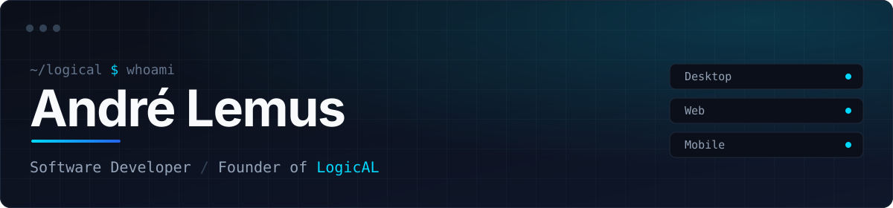

<div align="center">



<br/>

[](https://github.com/sombra2323/sombra2323/raw/main/assets/CV-Andre-Lemus.pdf)
[](https://logicalmx.netlify.app)
[](https://www.linkedin.com/in/%C2%A9-logical-bb5aa5304)
[](mailto:andre23negocios@gmail.com)
[](https://instagram.com/logical_mx)

</div>

<br/>

## About

```ts
const andre = {
  role: "Software Developer & Founder",
  company: "LogicAL",
  location: "México",
  education: "Software Engineering",
  focus: ["Desktop", "Web", "Mobile"],
  building: ["NoteSoftware", "Layenly", "OnionAI"],
  learning: ["Android", "SaaS architecture", "Cloud", "AI"],
  principle: "Build software that solves real problems.",
} as const;
```

<br/>

## Projects

| Project | What it is | Status |
|:--|:--|:--|
| **NoteSoftware** | Attendance and management SaaS with education and business editions | `Active` |
| **NoteAcademy** | QR-based attendance platform for schools | `Active` |
| **Layenly** | Fan fiction and alternate endings platform, built with React and Tailwind | `Building` |
| **InkerTattoos** | Platform for tattoo studios | `Active` |
| **OnionAI** | Artificial intelligence project | `Active` |
| **Aether** | Weather platform | `Shipped` |

<br/>

## Stack

<table>
  <tr>
    <td><b>Languages</b></td>
    <td></td>
  </tr>
  <tr>
    <td><b>Web</b></td>
    <td></td>
  </tr>
  <tr>
    <td><b>Desktop &amp; Mobile</b></td>
    <td></td>
  </tr>
  <tr>
    <td><b>Data</b></td>
    <td></td>
  </tr>
  <tr>
    <td><b>Tools</b></td>
    <td></td>
  </tr>
</table>

<br/>

## GitHub

<div align="center">


</div>
